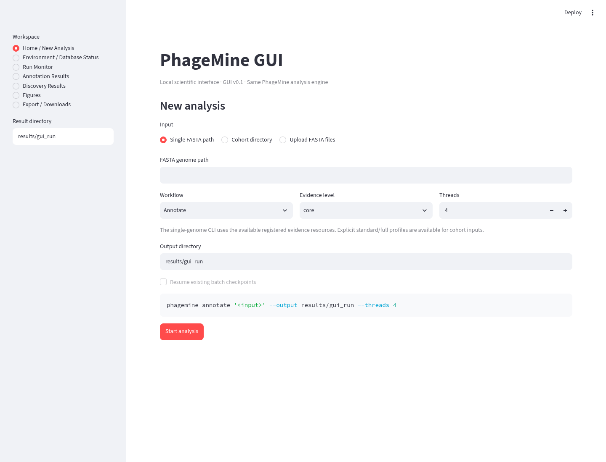
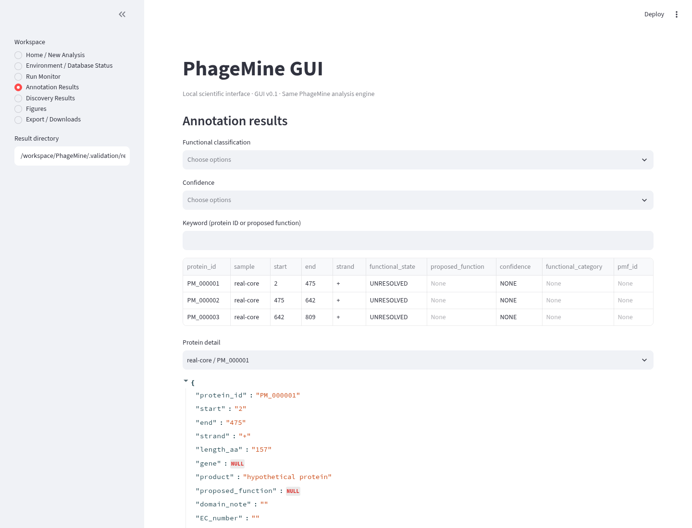

# Local graphical interface



Captured from this development branch on 2026-10-03, using the actual browser
interface. This is not a screenshot certifying the published v1.2.0 release.

The GUI is included in the standard PhageMine installation:

```bash
python -m pip install .
phagemine-gui
```

Your default browser opens automatically after the server is ready. The
printed address is usually `http://127.0.0.1:8501/`; if that port is busy the
launcher selects a free port. If no desktop browser is available, copy the
printed address. Keep the terminal open and press Ctrl+C to stop.

Use `phagemine-gui --port 8502` to choose a port or
`phagemine-gui --no-browser` to suppress browser opening. `phagemine gui`
accepts the same options. The `[gui]` installation extra is retained for older
commands, but is no longer necessary.

The launcher listens on localhost and disables Streamlit usage telemetry. Uploaded
FASTA files use temporary local storage during the run. Evidence-resource
installation still requires downloads from their providers.

## Start an analysis

Select a single FASTA file, a directory of FASTA genomes, or uploaded FASTA
files. Upload filenames must be unique. A directory must contain FASTA files;
a directory cannot be used as a single file. Home paths such as `~/genomes`
are supported.

Choose the output directory and workflow. For directory or upload inputs,
Annotate, Discover and Both use the corresponding batch workflow. Standard
and full evidence profiles apply to batch input. Single-file input delegates
to the CLI's annotate, mine or run command and uses available registered
resources; its `core` label does not mean databases are unused.

Use Environment / Database Status before a long run. Enable the operational
format check to include deep Doctor checks. The table includes external
executables, Python providers and workflow capabilities.

The interface streams console output while the subprocess runs and saves
`gui_console.log` with the results. Leave the page open until completion; use
**View results** or **Open latest results** to switch to the completed run.
Background execution, cancellation and concurrent jobs are not implemented.
Run Monitor reads saved checkpoints; recorded RUNNING state does not establish
that an operating-system process is still alive.

## Review results

Set the sidebar Result directory to your output path. Annotation Results shows
each sample once in Both mode and identifies a protein by sample and protein
ID. Discovery Results resolves the discovery subdirectory in Both mode and
the comparative subdirectory of a single complete run.

Run Monitor requires a finished manifest before declaring completion. Failed
samples remain failed even if their message is absent. Corrupt status files
produce warnings and prevent a completion claim. Both requires completed
annotation and discovery outputs.

Export / Downloads lists native artifacts, including the `.fsa` submission
FASTA. Download a selected file directly or select Prepare result ZIP to build
an archive on demand. The prepared ZIP remains available across page refreshes
in the same session while that result folder is selected. Symbolic links
are excluded. ZIP preparation uses memory proportional to the compressed
archive; copy the output directory directly for very large datasets.

Computational products and evidence-strength labels need scientific review.
The GUI does not establish functional accuracy or experimental confirmation.



The bundled input is synthetic and no evidence databases were installed in
this check; unresolved functions are expected.

## Development review pages

Version 1.3.0.dev0 includes Review / Curation for evidence-backed annotation edits saved to a separate result directory, and RNA Features for feature tables and provider provenance. See [annotation workflows](annotation-workflows.md) for CLI equivalents and supported features.

## Run on a remote workstation

Start the GUI on the workstation without opening its browser:

```bash
phagemine-gui --no-browser --port 8501
```

From your own computer, forward the local port through SSH:

```bash
ssh -L 8501:127.0.0.1:8501 your-user@your-workstation
```

Open `http://127.0.0.1:8501/` locally. Paths and output folders refer to the
workstation; use file upload for inputs from your own computer. This local
application has no user authentication. Keep it on loopback or behind an
authenticated access layer; it is not a public multi-user hosting service.

If browser opening fails, use the printed link. A deliberately selected busy
port fails with a clear message instead of opening another application's page.

## Ask PhageMine (first version)

Choose **Ask PhageMine** in the sidebar and type a supported request:

- `Annotate my genome` opens the existing analysis workflow, where you can upload
  FASTA files and start the run without entering a command.
- `Find the capsid gene` searches saved product names and gene labels.
- `Explain PM_000001` displays matching records, coordinates and saved evidence.
- `Summarize my results` reports annotation, sample, unknown-product and conflict counts.
- `Compare my genomes` displays existing native family, membership and recurrence
  tables, or explains how to prepare the cohort workflow.
- `Check my installation` opens tool and database diagnostics.

Set **Result directory** to the completed run to query. Changing this folder clears
an earlier question so results are not silently attributed to another run. Search
matches annotation text, not raw sequences. No match does not establish biological
absence. Original evidence and source directories are visible with each hit.

This first version uses deterministic offline phrase matching, not a generative
language model. It has no API key requirement, sends no data to an AI provider,
and never executes text as code. Unrecognized requests receive guidance instead
of a guessed answer. Annotation still requires the normal tools and databases;
comparison uses already computed outputs and does not infer homology from names.
Free-form conversational interpretation and automatic multi-step task planning
remain future work.
